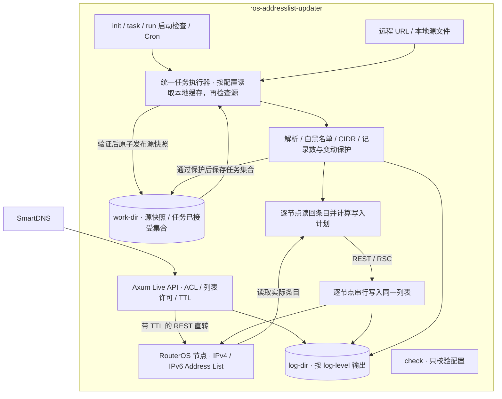

# ros-addresslist-updater 设计说明

原始配置构想见 [mind.yaml](mind.yaml)，可执行示例和命令说明见 [使用指南](usage.md)。

## 1. 功能与总体架构

Rust 单进程维护 RouterOS IPv4 / IPv6 Address List。静态任务消费远程 TXT、本地文件或共享 GeoIP DAT。SmartDNS 经 Live API 写入临时地址。RouterOS 以既有列表执行防火墙和路由策略。Dashboard 留待后续，复用手动执行、状态日志和 Live API。



## 2. 配置继承与调度入口

正式配置采用 `global-settings`、`ros-endpoints`、`geoip-updater`、`task-lists` 和 `api`。建议将 `geoip-updater` 整理为包含 `source`、`scheduler` 的映射，`ros-addresslist-updater` 空段保留在原始草稿中。任务名默认也是 RouterOS 列表名。 RouterOS endpoint 的 `ssl` 决定 REST 协议。`ssl: no` 使用 HTTP，`ssl: yes` 使用 HTTPS 并校验证书。两者均使用 endpoint 配置的 `port`。建议省略时按 `yes` 处理，测试节点使用 HTTP 时显式设为 `no`。SSH/SFTP 独立使用 SSH 端口。所有入口共用配置校验，检查 YAML 语法、字段类型、必填字段、重名、未知节点、枚举、Cron、时间、百分比及上下限。任务名首字符必须为 ASCII 字母或数字，任何位置均禁止 `*`。`*` 和 `*geoip` 是 CLI 保留选择器。

**全局带星号的 12 项全部可逐任务覆盖。** 有效值按任务显式配置、全局值、内置默认值的顺序解析。

| 全局字段 | 任务字段 | 语义 |
| --- | --- | --- |
| `default-scheduler` | `scheduler` | TXT 任务 Cron，六段含秒。GeoIP 列表由共享更新器触发，任务 Cron 对其无效。 |
| `download-timeout` / `download-retry` / `download-order` | 同名 | 单次下载超时、首次失败后的重试次数、候选源顺序。顺序支持 `sequential/sequ`、`random/rand`。 |
| `check-onstart` | 同名 | `run` 启动时是否立即检查该任务。 |
| `task-timeout` | 同名 | 一轮任务的总预算，包含来源检查、处理和节点同步。 |
| `optimize-cidr` | 同名 | 可选等价合并 CIDR。 |
| `diff-update` / `update-method` | 同名 | 按差异更新或重建管理集合，提交方式为 `api` 或 `rsc`。 |
| `min-record-size` / `max-record-size` | 同名 | 最终待下发 CIDR 数上下限，示例为 10 至 10000，含边界。 |
| `record-diff-threshold` | 同名 | 相对上一份已接受任务集合的最大允许变动比例，默认 `50%`。 |
| `apply-endpoints` | 同名 | 与启用节点取交集。无配置时使用所有启用节点。 |

`work-dir`、`log-dir`、`log-level`、`first-run`、注释前缀、`use-etag`、`diff-algo` 和占位字段 `ip-type` 属于全局配置。配置中的相对本地路径建议以配置文件目录为基准。共享 GeoIP 下载只有一次，下载参数建议由 `geoip-updater` 自身覆盖全局默认值。GeoIP 列表任务仍可配置带星号字段，其中下载参数应用于实际拥有独立来源的任务，共享下载使用更新器自己的有效值。

| 入口 | 行为 |
| --- | --- |
| `init` | 要求 `first-run: yes`。检查全部启用任务及所需数据，全部通过解析和最小、最大记录数检查后才开始 RSC 导入，执行完成即退出。有无历史基线均跳过变动比例限制。之后手动改回 `no`。 |
| `run` | 为 `check-onstart: yes` 的启用任务立即执行一轮，同时注册后续调度。为需要启动检查的 GeoIP 任务合并一次共享来源检查。 |
| `check` | 只加载并校验配置。成功退出为 0，语法或配置错误时输出字段或任务位置并返回非零。校验过程不下载、不更新缓存、不连接 RouterOS。 |
| `task <name>` | 立即运行指定的启用任务，GeoIP 列表任务从共享快照取数。 |
| `task '*'` | 立即执行全部启用任务一次，有 GeoIP 列表时先检查一次共享 DAT，每个列表只执行一次。 |
| `task '*geoip'` | 手动触发共享 GeoIP 更新器，检查 DAT 并按 GeoIP 触发规则处理关联任务。 |
| `task <name> --init` | 用初始化流程清空并重建指定启用的任务列表。 |
| `task '*' --init` | 等同于独立的 `init` 命令。 |
| `task '*geoip' --init` | 检查一次共享 DAT，清空并重建所有启用的 GeoIP 关联任务列表。即使 DAT 未变化也执行。 |
| 计划任务 | TXT 按自身 Cron 执行。GeoIP 更新器按独立 Cron 运行，与 `task '*geoip'` 共用触发逻辑。 |

仅全量初始化入口校验 `first-run: yes`。在 shell 中给 `*`、`*geoip` 加引号，避免路径通配展开。GeoIP 更新器首次取得有效 DAT 或发现内容 HASH 变化时触发关联的启用任务。上轮未完成的关联任务可用同一快照重试。

显式执行和 Cron 均走同一套文件比较及变更逻辑。`check-onstart: no` 仅跳过常驻进程的即时检查。调度建议使用进程本地时区，并记录启动时区。同一任务避免重入，同一工作目录避免多个进程同时写入。

## 3. 文件缓存

### 缓存布局与文件名

每个 TXT 任务在 `work-dir/sources/<任务名>/<来源标识>/` 保留当前有效快照。共享 GeoIP DAT 放在 `sources/_geoip/<来源标识>/`。来源标识由远程主机名或本地文件名，加完整 URL 或解析后的本地绝对路径的 BLAKE3 前 16 位组成。镜像各自保存 ETag 和快照。文件名中的内容 HASH 独立用于比较原始字节。

```text
<HOSTNAME>_<FILENAME>_<ETAG>_<HASH>_<YYYYMMDDHHMMSS>
```

| 字段 | 取值 |
| --- | --- |
| `HOSTNAME` | 远程 URL 的主机名或 IP。本地路径建议用固定值 `local`。 |
| `FILENAME` | 配置 URL 路径或本地路径的末段文件名。建议 URL 缺少文件名时用 `index`。 |
| `ETAG` | 当前源响应的 ETag。服务器未提供、关闭 ETag 或本地路径使用占位值 `none`。文件名中使用文件系统安全编码，发送条件请求时还原原始值，包括引号和弱标签前缀。 |
| `HASH` | 文件原始字节的完整 BLAKE3 十六进制摘要，用于判断文件内容是否变化。 |
| `YYYYMMDDHHMMSS` | 建议采用 UTC 的 14 位快照发布时间，用于诊断和识别版本。 |

例如 `raw.githubusercontent.com_chinanet.txt_<ETAG>_<HASH>_<YYYYMMDDHHMMSS>`。各字段采用可逆的文件名编码，字段内的下划线也转义，避免分隔符歧义。

### 统一比较与发布流程

`--nocache` 是全局命令行选项。远程源直接请求完整文件，省略缓存 ETag 的条件请求。本地源直接读取原文件。新文件通过验证后发布快照，再继续生成目标列表、执行条数和变动比例检查以及同步。`task '*geoip' --nocache` 会处理关联任务，即使新下载的 DAT 内容与上次相同。

1. 从任务配置解析候选 URL 或本地路径，先定位并读取当前有效本地缓存。初始化、常驻启动检查、手动运行和定时任务复用同一流程。缓存缺失或损坏时重新获取来源。
2. 远程有可用缓存和 ETag 时发送 `If-None-Match`。304 复用已有本地文件。200 将响应流写入源目录的临时文件并计算 HASH。TXT 和 GeoIP 的 `source` 都支持本地文件。读取时将源字节复制到工作目录下的临时文件并计算 HASH，本地来源只按 HASH 比较，文件名的 ETag 段用 `none`。首次读取或内容变化时发布副本，内容相同时保留现有副本。后续解析使用工作目录快照，源文件保持原位。
3. HASH 相同时复用缓存内容，删除临时文件。若服务器换了 ETag，建议在保留同一内容 HASH 的前提下更新缓存文件名并保存新标签。HASH 不同时先验证文件可解析，再将临时文件在同一文件系统中重命名为最新版。新版本成功发布后才清理旧文件。若进程在清理前退出，重启选择最新的完整快照并清理残留。源目录内串行发布。
4. 所有候选源均失败时保留旧缓存和 RouterOS 现状，记录失败。只有成功的 304 或验证通过的来源才能参与本轮任务计算。空响应、截断文件和无效 DAT 不发布。
5. 任务继续用缓存文件和当前本地白黑名单计算期望集合。来源字节未变时，仍可发现名单文件编辑、处理选项变化、节点漂移和上轮失败。共享 DAT 的字节变化触发关联任务，变化判断以所读 DAT 的 HASH 为准。

源缓存反映取得并验证格式的原始文件。另在 `work-dir/tasks/` 按任务名和地址族原子保存上一份**已通过任务保护的规范化 CIDR 集合**，为记录变动比例提供基线。GeoIP 多任务共用源文件，各有自己的集合基线。超阈值的任务保留旧基线，源快照仍可供其他任务评估。

- `sources/<任务名>/<来源标识>/` 存放原始 TXT。多个 GeoIP 列表共用 `sources/_geoip/` 中的 DAT。
- `tasks/<任务名>/ipv4.txt` 或 `ipv6.txt` 保存阈值基线，每行一个 CIDR。
- 首次执行任务时按当前配置定位旧哈希路径。旧基线迁移到新路径。历史 `managed/` 目录由旧版生成，新版同步仅读取 RouterOS 当前状态。旧源快照按需复制，以供仍引用同一来源的任务迁移。任务改名同时改变 RouterOS 列表名，需要显式迁移。
- `rsc/` 保存导入期间临时生成的脚本。`geoip-applied` 保存最近成功处理的共享 DAT 内容摘要。`.lock` 用于同一工作目录的进程互斥。

## 4. 列表计算与变动保护

TXT 按行解析，去掉内联注释和空行。单 IP 规范化为 `/32` 或 `/128`，CIDR 对齐网络地址。GeoIP 直接移植 `geoip-extract/src/lib.rs` 的 protobuf 结构、`extract`、`extract_entry` 和 `prepare` 实现，沿用大小写无关的标签匹配、地址族和前缀校验、地址归一化及 CIDR 处理逻辑。多个标签的结果取并集。移植时保留对应测试用例。白黑名单允许内联和文件输入，混合地址族按任务筛选。处理顺序为 **源集合 → 处理白黑名单冲突并应用名单 → 去重与可选合并 → 校验最终条数和变动比例**。

白黑名单规则直接移植 `geoip-extract/src/rules.rs` 的实现，包括跨名单重叠规则的抵消及黑名单丢弃整条重叠 CIDR 的行为。本项目负责源文件 BLAKE3 比较和规范化 CIDR 集合增删计算。源文件比较使用原始字节的摘要，集合比较使用规范化后的条目。

按排序、去重后的 CIDR 条目比较，令 `old` 为上次已接受集合、`new` 为本轮集合：

```text
变动比例 = (新增条数 + 删除条数) / old 条数
```

例如 100 条中替换 30 条的实际变动比例为 60%，超过默认 50%。恰好等于阈值允许通过。超阈值时记录 WARNING，包含新旧总数、新增、删除、比例、阈值和基线摘要，停止该任务全部节点写入，也保留旧任务基线。无历史基线时执行最小和最大记录数检查，通过后建立首份基线。`init` 始终豁免变动比例阈值，仍检查最小和最大记录数。基线按任务接受数据的时点更新，节点是否应用成功由读回、差异计算和逐节点结果体现。

## 5. RouterOS 与 Live API

- TXT 和 GeoIP 普通地址不写注释。白名单实际添加的条目有备注时用配置前缀包裹，例如 `== 备注 ==`。同一 CIDR 的不同备注用 ` | ` 连接，无备注时省略 comment，黑名单命中的条目会被排除。常规增量同步会按当前配置修正旧格式的注释。Live 使用独立标记。每个任务独占对应地址族下的静态列表，任务会把名单之外的同列表静态条目移除。手工条目使用其他列表。常规同步保留 Live 动态条目。
- REST 每轮从 RouterOS 读取任务列表并按 CIDR 计算增删。删除和编辑前再次读取列表，按地址、地址族和静态属性匹配，使用查询返回的当前 ID。增量模式先新增，新增失败时跳过后续删除。任务基线只用于变动比例。
- RSC 提交采用 SFTP 上传、SSH 显式执行 `/import`、REST 读回核验。常规更新通过 `find where` 按列表名、地址及静态属性定位删除和编辑对象。初始化固定使用 RSC，按列表名一次查找并批量删除该地址族列表中的全部条目（含 Live 动态条目），再导入静态集合。空列表直接导入。日常 `diff-update: no` 只重建静态集合。
- Axum 提供配置指向的 `POST /api/v1/live`。依据连接对端 IP 匹配 `network-acl`，检查目标列表许可和地址族。首版建议每次提交一个主机地址和可选 TTL，默认 300 秒。每个通过校验的请求直接转发到目标 RouterOS 节点，记录转发及逐节点结果。RouterOS 负责条目一致性、重复请求和 TTL 到期。本地只写操作日志，Live 地址不进入本地状态、缓存或静态任务基线，也不预查、去重或刷新条目。后续再评估减少 RouterOS 请求量的缓存方案。

[RouterOS REST API](https://help.mikrotik.com/docs/spaces/ROS/pages/47579162/REST%20API) · [RSC 导入](https://help.mikrotik.com/docs/spaces/ROS/pages/328155/Configuration%20Management) · [Address Lists](https://help.mikrotik.com/docs/spaces/ROS/pages/130220135/Address-lists)

### RSC 提交流程

Rust 调用系统 OpenSSH 的 `sftp` 和 `ssh`，通过已核验的 `known_hosts` 校验主机密钥。节点的 SSH 地址默认沿用 endpoint 地址，SSH 端口默认 22，SSH 用户默认沿用 `username`。配置 `ssh-key` 时使用密钥认证，否则使用配置文件中该节点的 `password` 进行非交互密码认证。REST 同样读取该字段，并使用自己的端口读取实际条目及核验结果。运行配置默认为 `conf/config.yaml`。

1. 根据节点实际条目和任务计划生成普通 `.rsc` 文件。使用本程序生成的唯一路径，脚本的写入范围限于目标地址族和任务列表。
2. 以 SFTP 批处理模式上传到 RouterOS。上传成功后，通过无交互 SSH 执行 `/import file-name=<文件名> verbose=no`。
3. 记录导入输出，并用 REST 比对导入后的受管条目。核验通过后清理远端脚本。导入失败或 SSH 超时后先读回，下一次按实际状态生成新计划。上传失败时终止该节点的提交。

RouterOS 导入按行执行，遇错前已经执行的行会保留。实机验收覆盖目标版本的 SFTP 权限、SSH 命令执行、部分导入、超时读回和接近记录上限的耗时。 [RouterOS SSH](https://manual.mikrotik.com/docs/management-tools/ssh/) · [RouterOS import](https://manual.mikrotik.com/docs/cli-reference/import/)

## 6. 日志与交付验收

DEBUG 的 `record counts` 汇总各任务的源记录数（GeoIP 按 tag 分列），白黑名单按当前地址族统计有效原始条数。`duplicates` 统计处理时跳过或合并的相同 IP / CIDR。`optimize` 统计白名单被更大网段覆盖而跳过的条数，以及启用 CIDR 优化后额外减少的条数。`white-added`、`black-removed` 是白名单实际新增和黑名单实际剔除的条目数。

`log-dir` 保存文件日志，示例为 `/tmp/ros-addresslist-updater/logs`。`log-level` 控制最低日志等级，支持 `trace/debug/info/warn/error`，示例为 `debug`。建议通过 `tracing` 同时向终端和日志文件输出，按日分文件。启动时检查目录可写。日志记录入口、任务、来源、缓存命中或变化、阈值拒绝、各节点结果和耗时，省略凭据与 URL 查询参数中的敏感信息。手动执行返回总结果，发生失败、保护拒绝或节点部分成功时返回非零退出码。

| 实现阶段 | 验收要点 |
| --- | --- |
| 配置与缓存 | 12 项任务覆盖生效。本地及远程同名文件不碰撞。覆盖 304、相同 HASH、新 ETag、内容变化、下载中断、原子发布与旧缓存保留。 |
| TXT、保护及 REST | IPv4 / IPv6 端到端。覆盖基线上下限、等于阈值、超阈值零节点写入、重复调度仍拒绝、节点部分失败后读回收敛。 |
| GeoIP 与调度 | 共享文件只下载一次，多个任务独立验证。验证启动检查、关闭启动检查、`task '*geoip'` 与 GeoIP Cron 的触发一致性。 |
| RSC 与 Live | 验证 `check` 拒绝非法任务名且无写入、`init` 跳过变动比例但保留条数检查、RSC 部分导入后的恢复、以及 Live 的 ACL、请求直转、日志和无本地条目状态。 |

## 7. 实机验收记录

已在 RouterOS CHR 7.25.2 的测试列表验证 HTTP REST、SFTP 上传、SSH 导入、IPv4/IPv6 地址列表读回和 Live TTL 到期。已验证 RSC 初始化清空目标列表的静态及动态条目。Linux amd64 产物已交叉编译并确认是静态链接的 x86-64 ELF。
